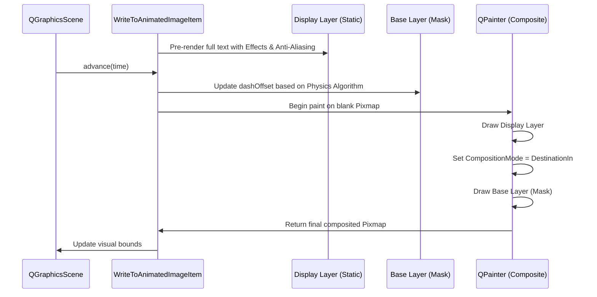

# Dual-Layer Rendering System

## Architectural Overview
The Dual-Layer System is a core structural pattern used in the `WriteToAnimatedImageItem` class. It was designed to solve critical rendering bugs related to sub-pixel aliasing and artifact generation when combining dynamic vector masking with high-fidelity `QGraphicsEffect` instances (like Drop Shadow and Neon Glow).

## The Problem
When a text element is converted to a vector path, the stroke is incrementally revealed by adjusting the `QPen`'s `dashOffset` and `dashPattern` properties. If a `QGraphicsEffect` is applied directly to this dynamically changing path, the Qt rendering engine attempts to recalculate the effect's bounding box and anti-aliasing buffers on every frame. This rapid, partial-pixel update cycle results in jagged edges (aliasing) and visual glitches.

## The Dual-Layer Architecture

The system decouples the mathematical animation from the visual rendering by utilizing two distinct `QGraphicsItem` layers:

### 1. The Display Layer (High-Resolution Static Output)
*   **Purpose:** To render the absolute highest quality version of the final text or shape, including all graphical effects.
*   **Mechanism:** This layer is an off-screen `QPixmap` or a static `QGraphicsPixmapItem`. It renders the complete, fully-drawn text exactly once at a high resolution multiplier (e.g., 2x or 4x internal scale for crispness).
*   **Effects:** All `QGraphicsEffect` objects (shadows, glows, blurs) are safely applied to this static layer, ensuring perfect anti-aliasing.

### 2. The Base Layer (Dynamic Animation Mask)
*   **Purpose:** To handle the physics-based writing algorithm and dictate *what portion* of the text is currently visible.
*   **Mechanism:** This layer contains the actual `QPainterPath` that is being manipulated over time (`t`). It draws the path in solid black (or white) without any anti-aliasing concerns and without any effects.

### The Composition Pipeline
To bring these layers together into the final output seen in the `QGraphicsScene`:

1.  A composite `QPixmap` is created for the current frame.
2.  A `QPainter` is opened on this composite pixmap.
3.  The **Display Layer** (the fully styled text) is drawn first.
4.  The `QPainter`'s composition mode is set to `QPainter.CompositionMode_DestinationIn`.
5.  The **Base Layer** (the current state of the animated mask) is drawn over it.
6.  *Result:* The mask cuts away the invisible parts of the Display Layer, leaving only the portion of the styled text that has been "written" up to the current frame.

## Sequence Diagram

## Benefits
1.  **Perfect Anti-Aliasing:** The visual layer is static, allowing Qt to anti-alias perfectly.
2.  **Stable Effects:** Shadows and glows do not jitter or recalculate bounds unnecessarily.
3.  **Performance:** Caching the Display Layer significantly reduces CPU load during playback, as only the un-styled vector mask needs to be redrawn each frame.
