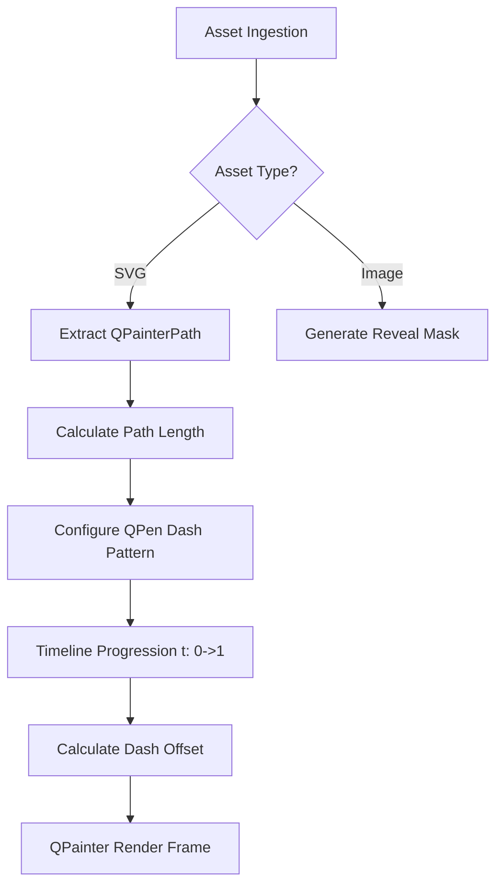

# Drawing Engine Rendering Pipeline

The Drawing Engine handles the conversion of static images and SVG paths into animatable sequences. The pipeline consists of three main stages: Ingestion, Processing, and Execution.

## 1. Ingestion Stage
*   **Vector Files (.svg):** Passed through `QSvgRenderer`. The engine traverses the XML tree to extract individual `<path>`, `<rect>`, `<circle>`, and `<line>` nodes, converting them into standard `QPainterPath` objects.
*   **Raster Images (.png, .jpg):** Analyzed for edge detection or converted to pseudo-vector paths via tracing algorithms (if required by the style), or assigned a standard "Reveal" mask (e.g., Solid Reveal, Wipe).

## 2. Processing Stage
Once the `QPainterPath` is established, the engine must prepare it for animation over time `T`.

1.  **Path Flattening:** Complex Bézier curves are often flattened into discrete line segments to accurately calculate the total arc length of the path.
2.  **Length Calculation:** The `QPainterPath.length()` is calculated. This is crucial as it represents the 100% completion state of the drawing.
3.  **Dash Pattern Setup:** A specific `QPen` is configured. The core trick for SVG drawing animation in Qt is utilizing the `dashPattern` and `dashOffset`.
    *   `dashPattern` is set to `[total_length, total_length]`.
    *   This creates a single "dash" that is exactly the length of the entire path, followed by a gap of the same length.

## 3. Execution Stage (Animation)
During playback, the time variable `t` progresses from `0.0` to `1.0`.

1.  **Offset Calculation:** The `dashOffset` is mathematically bound to `t`.
    *   At `t = 0.0`, `dashOffset = total_length`. The path is completely hidden because the "gap" of the dash pattern is currently being drawn over the actual geometry.
    *   At `t = 1.0`, `dashOffset = 0.0`. The path is fully visible because the "dash" part perfectly covers the geometry.
2.  **Rendering:** The `QGraphicsScene` triggers a `paint()` event, and the `QPainter` strokes the path with the updated pen properties.

## Flowchart

