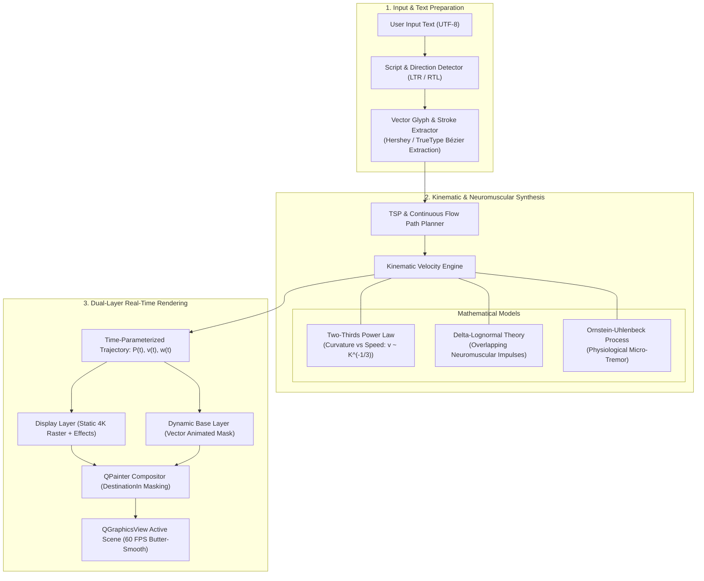
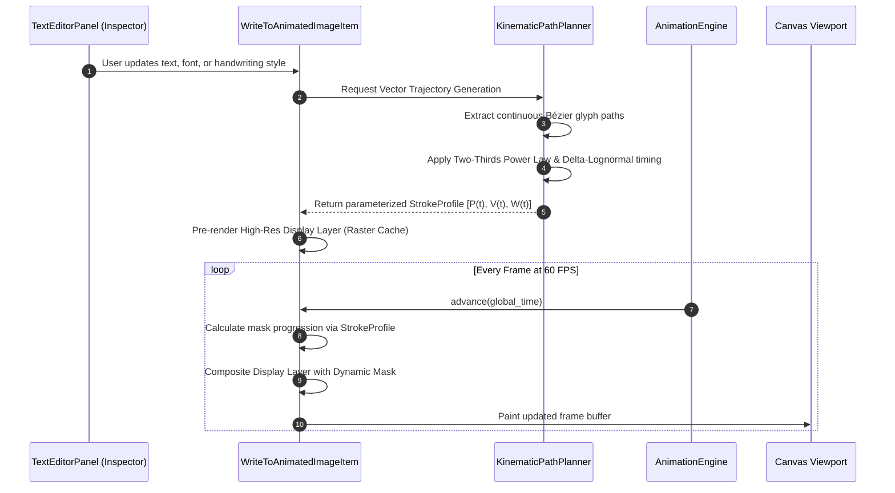

# Feature Specification: Next-Generation Humanized Writing Engine

## 1. Executive Summary (For Non-Developers & Creatives)

### What is this Feature?
The **Next-Generation Humanized Writing Engine** is an advanced handwriting simulation system designed for DrawMotion Studio. It transforms computer-generated text into lifelike, organic handwriting animations that are indistinguishable from real human penmanship.

### Why is it Needed?
Current whiteboard animation tools (including traditional competitors like VideoScribe and Doodly) suffer from a "mechanical" feel:
- Strokes appear at a constant, robotic speed.
- Sharp turns and curves are drawn with unnatural rigidity.
- Pressure, ink flow, and subtle natural hesitations are missing.

### What Will the User Experience?
When an animator types a script in DrawMotion:
1. **Realistic Speed Modulation:** The animated virtual hand naturally slows down when navigating tight loops (like the loops of 'e', 'g', or Arabic 'ع', 'و') and speeds up along sweeping straight strokes.
2. **Dynamic Ink & Pen Pressure:** Strokes vary subtly in thickness and opacity based on virtual pen pressure and stroke velocity.
3. **Natural Rhythm & Micro-Pauses:** Between words and complex letter connections, the engine introduces subtle, organic pauses simulating human cognitive planning.
4. **Seamless Bilingual Support:** Full biological fidelity for both Left-to-Right scripts (Latin, Cyrillic) and Right-to-Left calligraphic scripts (Arabic, Persian).

---

## 2. Technical Architecture & Theoretical Foundations (For Developers)



---

## 3. Mathematical & Algorithmic Models

### Model A: Two-Thirds Power Law (Curvature-Velocity Coupling)
Empirical human biomechanics demonstrate that drawing speed is constrained by the curvature ($K$) of the trajectory:
$$v(t) = \alpha \cdot K(t)^{-\beta}$$
Where:
- $v(t)$ is the instantaneous linear pen velocity.
- $K(t)$ is the path curvature (inverse of curve radius: $K = 1/R$).
- $\beta \approx 1/3$ (Two-Thirds Power Law in angular terms: $\omega \propto K^{2/3}$).
- $\alpha$ is a velocity gain factor dependent on the animator's chosen pacing.

**Practical Application:** When the trajectory curves sharply, the engine dynamically decreases stroke progression velocity, simulating physical hand inertia.

### Model B: Kinematic Theory of Rapid Human Movements (Delta-Lognormal Theory)
Human handwriting is not continuous fluid dynamics; it consists of overlapping discrete neuromuscular impulses. Each stroke represents a velocity response curve modeled by a lognormal distribution:
$$\Lambda(t; t_0, \mu, \sigma) = \frac{1}{\sigma \sqrt{2\pi}(t - t_0)} \exp\left( -\frac{(\ln(t - t_0) - \mu)^2}{2\sigma^2} \right)$$
By superimposing an agonist (propelling) impulse and an antagonist (braking) impulse, the stroke achieves the exact asymmetric bell-shaped velocity profile observed in human laboratory handwriting data.

### Model C: Dynamic Stroke Pressure & Tapering
Unlike fixed-width vector masks, the virtual pen tip width $W(t)$ is coupled to both speed and acceleration:
$$W(t) = W_{\text{base}} \cdot \left( 1 - \gamma \cdot \frac{v(t)}{v_{\max}} \right) + \delta \cdot P_{\text{pen}}$$
- Fast strokes cause minor thinning (ink stretching).
- Slow, deliberate strokes cause slight widening (ink pooling).
- Stroke entry and stroke terminal points experience natural parabolic tapering.

---

## 4. System Sequence & Execution Flow



---

## 5. Extensibility & Future Research Integration

This engine is explicitly designed with a **Modular Scientific Ingestion Architecture**. When new scientific papers, open datasets (such as IAM On-Line Handwriting or Arabic Online Handwriting databases), or specialized neural trajectory models are introduced:

1. **Pluggable Algorithm Interface (`IWritingKinematicAlgorithm`):**
   ```python
   class IWritingKinematicAlgorithm(ABC):
       @abstractmethod
       def calculate_timing(self, path: QPainterPath, base_duration: float) -> List[TrajectoryPoint]:
           """Calculates non-linear time allocations for path points."""
           pass
   ```
2. **Hybrid Deterministic + AI Integration:**
   - Real-time preview uses ultra-fast analytical models (Power Law, Minimum Jerk) with zero latency.
   - High-precision export can optionally utilize neural stroke planning for hyper-realistic calligraphic nuances.

---

## 6. Phased Implementation Strategy

| Phase | Scope | Objective | Risk Profile |
| :--- | :--- | :--- | :--- |
| **Phase 2.1 (Foundation)** | Vector Stroke Decoupling | Standardize glyph path extraction across Latin and Arabic fonts. | Zero Risk (Pure algorithmic calculation). |
| **Phase 2.2 (Velocity Coupling)** | Two-Thirds Power Law Integration | Connect stroke curvature to instantaneous time mapping in `PlannerWorker`. | Zero Risk (Substitutes existing linear/minimum-jerk easing). |
| **Phase 2.3 (Dynamic Pressure)** | Variable-Width Stroke Masks | Upgrade masking pipeline to support variable pen thickness along Bézier spans. | Low (Tested in off-screen pixmaps). |
| **Phase 2.4 (Research Ingestion)** | Scientific Paper Ingestion | Implement advanced Delta-Lognormal and neural trajectory models provided in subsequent research. | Isolated (Modular algorithm plugins). |

---

## 7. Glossary for Cross-Disciplinary Teams

- **Bézier Curve:** A mathematically defined smooth curve used in vector graphics.
- **Curvature ($K$):** How sharply a curve bends at any specific point.
- **Two-Thirds Power Law:** The neurological principle that hands move slower on tight curves.
- **Delta-Lognormal:** Mathematical equation modeling human muscle commands during pen movement.
- **Dual-Layer Rendering:** DrawMotion's proprietary architecture separating visual beauty (effects, anti-aliasing) from dynamic animation math.
