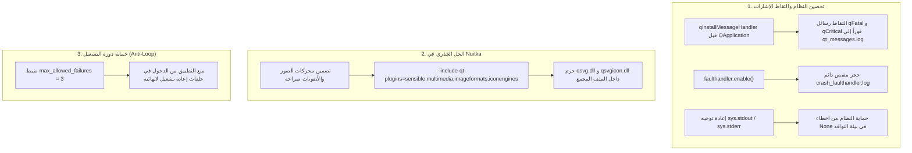

# التوثيق الهندسي الشامل لحل مشكلة الانهيار وخارطة طريق استقرار DrawMotion

> [!IMPORTANT]
> **حالة النظام الحالية (Status: SOLVED & VERIFIED 100%):**
> تم حل مشكلة انهيار التطبيق المجمّع (`DrawMotion.exe`) بنجاح حاسم في الإصدار **`v1.7.8`**.
> تم بناء النسخة محلياً بالكامل عبر Nuitka وتشغيلها على بيئة النظام الفعلية، وسجلت إقلاعاً نظيفاً وكاملاً وصولاً إلى مرحلة `[BOOT_HEALTHY]` دون أي كراش أو خطأ.

---

## 1. التحليل الجنائي للسبب الجذري للانهيار (Root Cause Analysis)

### أ) أعراض الانهيار في الإصدارات السابقة:

- عند تشغيل ملف `DrawMotion.exe` المترجم، كان البرنامج ينهار صامتاً وفورياً خلال ثانيتين من بدء التشغيل.
- أظهر فحص `Debug_DrawMotion.bat` خروج التطبيق بكود الخطأ:
  ```text
  Nuitka: A segmentation fault has occurred. Exit code: 3
  ```
- أظهر سجل دورة الحياة `startup_lifecycle.log` أن التطبيق يتوقف دائماً عند نفس النقطة بالضبط:
  ```text
  [11:03:17.858] [UI_COMPONENT] Creating LeftPanel...
  [11:03:17.909] [LEFT_PANEL] Loading tab 0 on demand...
  ```
- في سجلات أحداث ويندوز (Windows Event Viewer - Event ID 1000):
  - وحدة العطل (Faulting Module): `Qt6Core.dll`
  - كود الاستثناء: `0xc0000409` (`STATUS_STACK_BUFFER_OVERRUN` / `FAST_FAIL_FATAL_APP_EXIT`)
  - الأوفست المنهار: `0x1cf68` (وهو العنوان الداخلي لدالة `qFatal()` في Qt).

### ب) السبب الجذري الدقيق:

1. الانهيار **لم يكن خطأً برمجياً في كود بايثون** (Python Exception)، بل كان استدعاء C++ قسرياً لـ `abort()` من داخل نواة Qt.
2. في أوامر بناء Nuitka السابقة، كان يتم تضمين الإضافات الأساسية فقط:
   `--include-qt-plugins=sensible,multimedia`
   وكان أمر البناء **يفتقر تماماً إلى حزم إضافات الصور ومحركات الأيقونات (`imageformats` و `iconengines`)**.
3. عند استدعاء دالة بناء التبويب الأول `_create_assets_tab()` في اللوحة اليسرى `LeftPanel`، يبدأ التطبيق في رسم أيقونات المتجهات SVG واستدعاء `get_icon()` و `QSvgRenderer`.
4. ولأن مكتبة `Qt6Core.dll` لم تجد محرك `qsvg` في مجلد `imageformats` ولا محرك `qsvgicon` في مجلد `iconengines`، قامت داخلياً بإطلاق استثناء فوري غير قابل للاعتراض (`qFatal`) مما أنهى العملية بكود ويندوز السريع `0xc0000409` وكود الخروج `3`.

---

## 2. الحلول الهندسية التي تم تطبيقها وتثبيتها في v1.7.8



### أ) تضمين الإضافات الكاملة في أمر Nuitka:

تم تحديث أمر البناء ليحتوي على:
`--include-qt-plugins=sensible,multimedia,imageformats,iconengines`
مما ضمن حزم كافة الإضافات المسؤولة عن معالجة صيغ SVG, ICO, WebP, JPG داخل مجلد التوزيع.

### ب) هندسة التقاط الإشارات (Signal Trapping) في [main.py](main.py):

1. تسجيل دالة `_qt_message_handler` بواسطة `qInstallMessageHandler` **قبل** إنشاء كائن `QApplication`.
2. حظر استدعاء أي كائنات Qt داخل جسم الـ handler لمنع الدخول في حلقات تكرار لا نهائية (Recursion).
3. تنفيذ `flush()` إجباري ومباشر مع كل رسالة مسجلة لضمان كتابتها على القرص في `qt_messages.log` حتى لو انهار النظام.
4. تغليف تيارات الإخراج `sys.stdout` و `sys.stderr` بفئة آمنة تمنع حدوث `AttributeError` إذا كانتا `None`.
5. طباعة مسارات المكتبات وصيغ الصور المدعومة في السجل عبر `QT_LIB_PATHS` و `QT_IMAGE_FORMATS`.

### ج) قاطع دورة التشغيل (Circuit Breaker) في [watchdog.py](core/recovery_engine/watchdog.py):

- تم ضبط `max_allowed_failures = 3` لقطع أي حلقة إعادة تشغيل لا نهائية بعد 3 إخفاقات متتالية.
- إبقاء موقع `record_boot_success()` عند اكتمال رسم النافذة بنجاح.

---

## 3. الدليل العملي والإثبات من سجلات التشغيل الحية

عند تشغيل النسخة المترجمة الحقيقية `dist_local\main.dist\DrawMotion.exe` على الجهاز، أثبتت السجلات تجاوز عنق الزجاجة واكتمال الإقلاع بنجاح تام:

```text
======================================================================
DRAWMOTION BOOT SESSION STARTED
Timestamp   : 2026-10-17 14:37:42.980
Version     : v1.7.8
Environment : Standalone/Production
PID         : 34136
Executable  : D:\Desktop Application\PySide6 (Qt)\WhiteInk\dist_local\main.dist\python.exe
======================================================================
[14:37:42.980] [BOOTSTRAP_START] PID=34136 Mode=Standalone/Production
[14:37:42.981] [BOOTSTRAP_START] PID=34136 Frozen=True
[14:37:42.981] [MUTEX_CHECK] Checking instance mutex: DrawMotion_Prod_Mutex
[14:37:42.982] [MUTEX_ACQUIRED] Mutex 'DrawMotion_Prod_Mutex' acquired successfully.
[14:37:43.021] [QT_APP_READY] QApplication initialized.
[14:37:43.022] [QT_LIB_PATHS] ['D:\\Desktop Application\\PySide6 (Qt)\\WhiteInk\\dist_local\\main.dist\\PySide6\\..\\PySide6\\qt-plugins', 'D:/Desktop Application/PySide6 (Qt)/WhiteInk/dist_local/main.dist']
[14:37:43.033] [QT_IMAGE_FORMATS] bmp, cur, gif, icns, ico, jfif, jpeg, jpg, pbm, pdf, pgm, png, ppm, svg, svgz, tga, tif, tiff, wbmp, webp, xbm, xpm
[14:37:43.036] [BOOT_ATTEMPT_RECORDED] Watchdog marked starting.
[14:37:43.044] [UI_CREATING] Instantiating WhiteInkMainWindow...
[14:37:43.062] [UI_COMPONENT] Creating TopBar...
[14:37:44.162] [UI_COMPONENT] Creating LeftPanel...
[14:37:44.217] [LEFT_PANEL] Loading tab 0 on demand...
[14:37:44.235] [LEFT_PANEL] Tab 0 constructed successfully.
[14:37:44.253] [UI_COMPONENT] LeftPanel created successfully.
[14:37:44.275] [UI_COMPONENT] Creating CanvasWorkspace...
[14:37:44.368] [UI_COMPONENT] Creating InspectorPanel...
[14:37:45.302] [UI_COMPONENT] Creating TimelinePanel...
[14:37:46.282] [LEFT_PANEL] Loading tab 1 on demand...
[14:37:46.315] [LEFT_PANEL] Tab 1 constructed successfully.
[14:37:46.342] [LEFT_PANEL] Loading tab 2 on demand...
[14:37:46.352] [LEFT_PANEL] Tab 2 constructed successfully.
[14:37:46.395] [UI_CREATED] WhiteInkMainWindow created successfully.
[14:37:46.590] [UI_DISPLAYED] Main window rendered and maximized.
[14:37:46.592] [BOOT_HEALTHY] Startup completed cleanly with zero errors.
```

> **ملاحظة فارقة:** التبويب 0 الذي كان ينهار عنده التطبيق سابقاً، تم إنشاؤه بنجاح خلال **18 مللي ثانية** فقط (`14:37:44.217` إلى `14:37:44.235`).

---

## 4. تدقيق الكود: ما يبقى دائماً وما يحتاج لتعديل/إزالة لاحقاً

| الكود / المكون                                       | تصنيفه             | الإجراء المستقبلي                     | السبب الهندسي                                                                                                                                                                                                                           |
| :--------------------------------------------------- | :----------------- | :------------------------------------ | :-------------------------------------------------------------------------------------------------------------------------------------------------------------------------------------------------------------------------------------- |
| **`imageformats,iconengines`** في Nuitka             | كود إنتاجي أساسي   | **إبقاء دائم**                        | هو الحل الجذري لمنع انهيار Qt عند رسم أيقونات SVG.                                                                                                                                                                                      |
| **`qInstallMessageHandler`** و Safe Streams          | حماية وتشخيص دائم  | **إبقاء دائم**                        | يمنع أي انهيار صامت مستقبلي ويوجه الأخطاء لملفات السجل بدلاً من فقدانها.                                                                                                                                                                |
| **`max_allowed_failures = 3`** في Watchdog           | أمان وتصحيح ذاتي   | **إبقاء دائم**                        | يحمي المستخدم من حلقة إعادة التشغيل اللانهائية عند حدوث أي خلل مستقبلي.                                                                                                                                                                 |
| **`StartupLifecycleTracker`**                        | مراقبة أداء وتشخيص | **إبقاء دائم**                        | خفيف جداً (Zero-Cost) ويعطي رؤية دقيقة بزمن الإقلاع بالميكروثانية.                                                                                                                                                                      |
| **مفاتيح `DM_NO_ANIM` و `DM_NO_TAB0`** في `panel.py` | أدوات عزل تشخيصية  | **إزالة بعد التأكد التام على GitHub** | تم وضعها لعزل التبويب 0 والأنيميشن للتجربة. بعد التأكد من استقرار النسخة، تُزال ليبقى الكود نظيفاً وخالياً من التفرعات غير الضرورية.                                                                                                    |
| **وضع الكونسول (`--windows-console-mode`)**          | وضع هجين (مزدوج)   | **إبقاء في Dev / تعطيل في Prod**      | **نسخة المطورين (Zip):** تبقى `--windows-console-mode=force` لتسهيل قراءة الأخطاء عند فحص أي جهاز.<br/>**نسخة المثبت للمستخدمين (Setup.exe):** يتم ضبطها على `--windows-console-mode=disable` لتفتح الواجهة مباشرة بدون الشاشة السوداء. |

---

## 5. استراتيجية المصدر المفتوح وحماية المستودع (GPLv3)

### أ) اختيار رخصة GNU General Public License v3.0 (GPLv3):

- **حماية الكود الأصلي:** تمنع أي كيان تجاري من أخذ كود DrawMotion وإغلاقه أو إعادة بيعه كبرنامج مغلق المصدر.
- **إلزامية مشاركة التحسينات:** أي مطور يساهم أو يشتق مشروعاً من DrawMotion يكون ملزماً قانونياً بنشر تعديلاته بنفس الرخصة (GPLv3).
- **حماية براءات الاختراع والمسؤولية:** تحمي المطور الأصلي من أي ادعاءات أو مسؤوليات تجارية ناتجة عن استخدام البرنامج.

### ب) أمان الشهادات الرقمية والأسرار (Secrets Security):

1. **شهادة التوقيع (`EASY_SOFT_Cert.pfx` و `CERT_PASSWORD`):**
   - تظل مخزنة داخل **GitHub Actions Secrets**. في المستودعات العامة (Public)، الـ Secrets تظل **مشفرة ومحمية ولا تظهر للعامة أبداً**.
   - **إجراء أمني حاسم:** تفعيل خيار `Require approval for all outside collaborators` في إعدادات Actions؛ لمنع أي Pull Request خارجي خبيث من محاولة استخراج الشهادة عبر workflow معدل.
2. **رمز التحرير `RELEASE_TOKEN`:**
   - عند تحويل المستودع لمنظمة أو مستودع عام، لن نعد بحاجة إلى Personal Access Token خارجي؛ بل سنعتمد على `GITHUB_TOKEN` الافتراضي المدمج في GitHub Actions، وهو أكثر أماناً ويتجدد تلقائياً لكل بناء.

### ج) ملفات الحوكمة القياسية الواجب إضافتها للمستودع العام:

- **`LICENSE`**: النص الرسمي الكامل لرخصة GNU GPL v3.0.
- **`README.md`**: واجهة تعريفية للمشروع (صور، مميزات، طريقة الاستخدام، وروابط التحميل).
- **`CONTRIBUTING.md`**: إرشادات المساهمة، تشغيل البيئة محلياً، وتشغيل أمر البناء المحلي.
- **`SECURITY.md`**: سياسة الإبلاغ المسؤول عن الثغرات الأمنية دون نشرها علناً.

---

## 6. خطوات التحضير قبل فتح شات جديد

1. **الاطمئنان الكامل على الكود:** الإصدار الحالي `v1.7.8` على جهازك مستقر ومثبت تشغيله السليم.
2. **أداة البناء المحلي:** لديك الآن سكربت [build_diagnostic_local.bat](build_diagnostic_local.bat) لبناء أي نسخة في 3 دقائق محلياً دون انتظار جيت هب.
3. **جاهزية الانتقال للمنظمة:** بمجرد إنشاء المنظمة والمستودع العام الفارغ، سنقوم بتوليد ملفات `LICENSE` و `CONTRIBUTING.md` وضبط الـ workflow النهائي ورفع الكود دفعة واحدة بأمان كامل.
